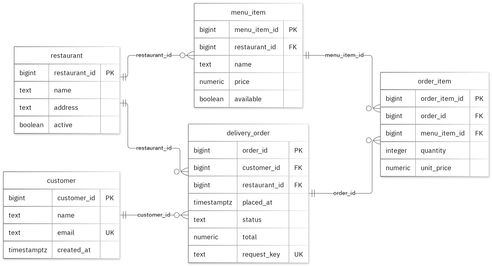

# MIT 8103 Advanced Database Systems

**Food Delivery App** · Boluwatife Abiona · Student ID 301928052

## Case study

My case study is the Food Delivery App. The database is designed to support customers placing food delivery orders, restaurant staff maintaining their menus and accepting orders and analysts reviewing order activity. The relevant tables are customer, restaurant, menu_item, delivery_order and order_item. The operations it supports are: maintain customer, restaurant and menu item records; place an order (which can contain one or more menu items); review orders and summarise item sales.

## Portfolio 1: Database Design and Modelling

The relational design comprises 5 tables. Primary keys are used to identify records, foreign keys ensure relationships between tables are maintained and checks ensure business rules are enforced. Prices cannot be less than 0 for a Menu Item. Normalisation examples demonstrate the sample data is in 1NF, 2NF & 3NF. All 18 invalid inserts were denied. Sample data was not altered.

Figure 1. Tables, keys and relationships. PK: primary key; FK: foreign key; UK: unique value.

<!-- PAGE BREAK -->

## Portfolio 2: Query Processing and Optimisation

Three SQL queries were run on the sample data. One row was retrieved when joining the two tables, Avery Chen from Cedars Kitchen was joined. Fifty thousand individual performance rows were used for the index comparison. The median lookup time varied between 2.357ms and 0.301ms. The same information was found in both stages of the query. The plan used was using the new index. These times are specific to this lookup and environment.

## Portfolio 3: Transactions and Concurrency

To test the behaviour of COMMIT, ROLLBACK and READ COMMITTED I used a temporary counter in delivery_order. Uncommitted updates are not visible to the other session. Using ROLLBACK restored the previously committed value. Without using any locks the value increased by 2. Using SELECT FOR UPDATE caused Session B to wait for Session A to complete and resulted in an increase of 3. The helper is limited to this scenario and the original business fields have not been changed.

## Portfolio 4: NoSQL and Advanced Data Models

I used the order_events collection for the events in the case. The MongoDB inserts two sample events and the queries return as expected (there are 4). Validation failed on an invalid date type and duplicate event ID. Snapshots are embedded and therefore related data is kept with the event. The details field will vary depending on the event type. The events are made up and PostgreSQL still enforces its rules.

## Repository and evidence

https://github.com/babiona8052-lang/Abiona_Boluwatife_301928052

The portfolio folders contain the SQL and JavaScript, explanations, query plans, result tables and screenshots.

<!-- PAGE BREAK -->

## Portfolio 5: Distributed and Cloud Database Exercise

3 replica members for MongoDB. Primary elections, majority acknowledge, secondary replication lag and order_events shard considerations. Replicated to provide availability. Backups provided to solve recovery. PostgreSQL had to have an availability solution. This is what was discussed. No deployment of a live replica set to test failover.

## Individual reflection

The data was stored in separate tables to avoid duplication. This included customer, restaurant, menu_item, delivery_order, and order_item. There were constraints in place to ensure that menu items had a positive price. The constraints were tested to ensure correct values and relationships between the records. The two session example demonstrated an issue with reading the same value in both sessions before any commits. To keep both increments, the row should be locked before reading. The index comparison demonstrates that it is important to check what the execution plan looks like as even if the same result is achieved there could be different levels of work required in the database.

## AI-use declaration

I used GitHub Copilot and the portfolio generator to help prepare the database model, scripts and explanations. The generator ran the PostgreSQL and MongoDB exercises, checked their outputs and captured the result images.  I remain responsible for checking and explaining the submitted work.

## References

- [PostgreSQL: constraints](https://www.postgresql.org/docs/17/ddl-constraints.html)
- [PostgreSQL: EXPLAIN](https://www.postgresql.org/docs/17/using-explain.html)
- [PostgreSQL: isolation](https://www.postgresql.org/docs/17/transaction-iso.html)
- [PostgreSQL: row locks](https://www.postgresql.org/docs/17/explicit-locking.html)
- [MongoDB: data modelling](https://www.mongodb.com/docs/manual/data-modeling/)
- [MongoDB: replication](https://www.mongodb.com/docs/manual/replication/)
- [MongoDB: sharding](https://www.mongodb.com/docs/manual/sharding/)
- [Mermaid: ER diagrams](https://mermaid.js.org/syntax/entityRelationshipDiagram.html)

